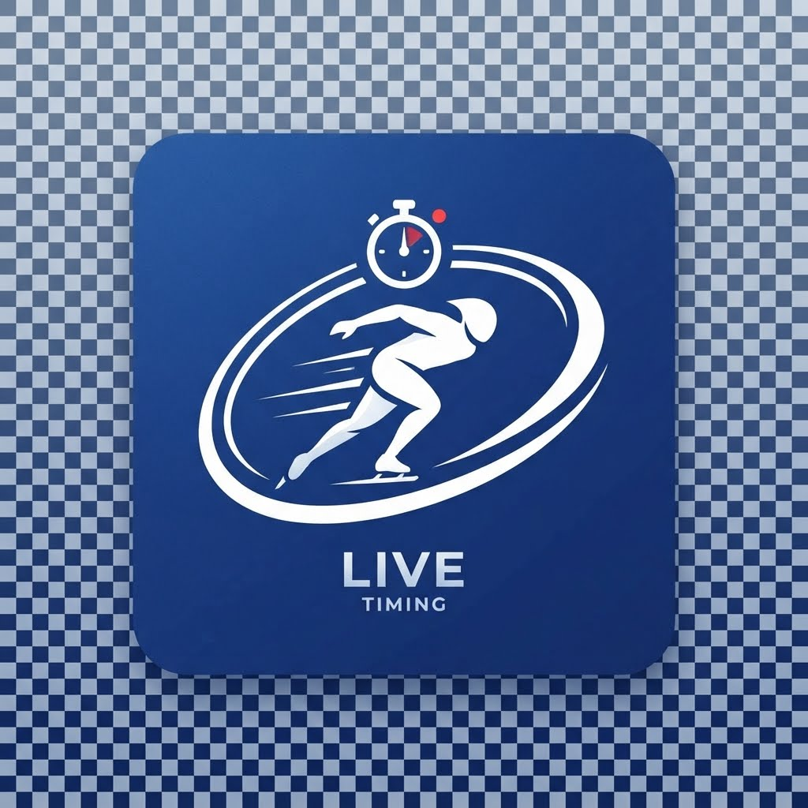

# Live Results Experiment - Proof of Concept

Experimental - non commercial.

## About
This is an experimental visualisation of publicly available results data. The data is not owned by this project: it is already published by its original source, and this project only displays it in a different way.

There is no commercial branding and no financial model. It is an open-source project that plots some ideas, in the hope that they help improve existing systems.

Developed with assistance from [Claude Code](https://claude.com/claude-code).

## Icon
The app icon (the original image is kept in [docs/images](docs/images/app-icon.jpeg)) was generated with Google Imagen 3. The prompt asked for a design that does not collide or match with any official brands related to the sport or its organisations.

## Documentation

See [docs](docs/README.md) for the architecture, the technology, hosting, configuration and the mockserver.
