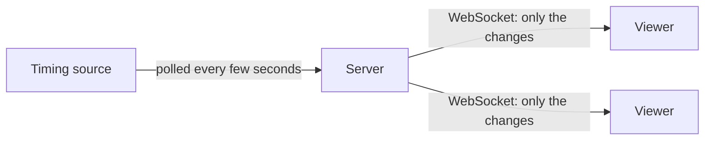

# Architecture

Three parts: the **timing source** publishes the results, the **server** watches it, and the **client** (the web page) shows them.

## Timing source

An outside service we don't own. It has two parts: the live results of a competition (one document with every distance, pair, skater and lap time) and a list of venues and competitions. It only answers when asked, and it is not always tidy: a race can show laps while it is still running, a heat can be reset, a skater can be replaced, a time can be corrected afterwards. Before a competition starts it reports that it isn't live yet.

## Server

- **One poller per competition**, however many people watch, so the source is never hammered. Nobody watching means no polling.
- **Remembers the last state** and sends viewers only what changed. Someone who joins late gets the full picture first.
- **Reconnecting is cheap:** a viewer that drops and returns is sent only what it missed, or the full picture if that isn't possible.
- **Limits** on viewers, connections per address and total audience protect a small host.
- **Today's competitions:** a list of what is on today, so the page can offer a choice.

## Client

- Opens one WebSocket to the server for the chosen competition (`?competitionId=` in the page address) and turns the messages into the dashboard.
- Applies large batches in small steps so the page never freezes, and reconnects by itself when the connection drops.
- Stops listening when the tab has been hidden for a while, and catches up when it is shown again.
- Calculations (times, standings, heat order) are plain functions, separate from the screen; see [Frontend structure](frontend-structure.md).

In production one container holds the page and the server ([Hosting](hosting.md)).
